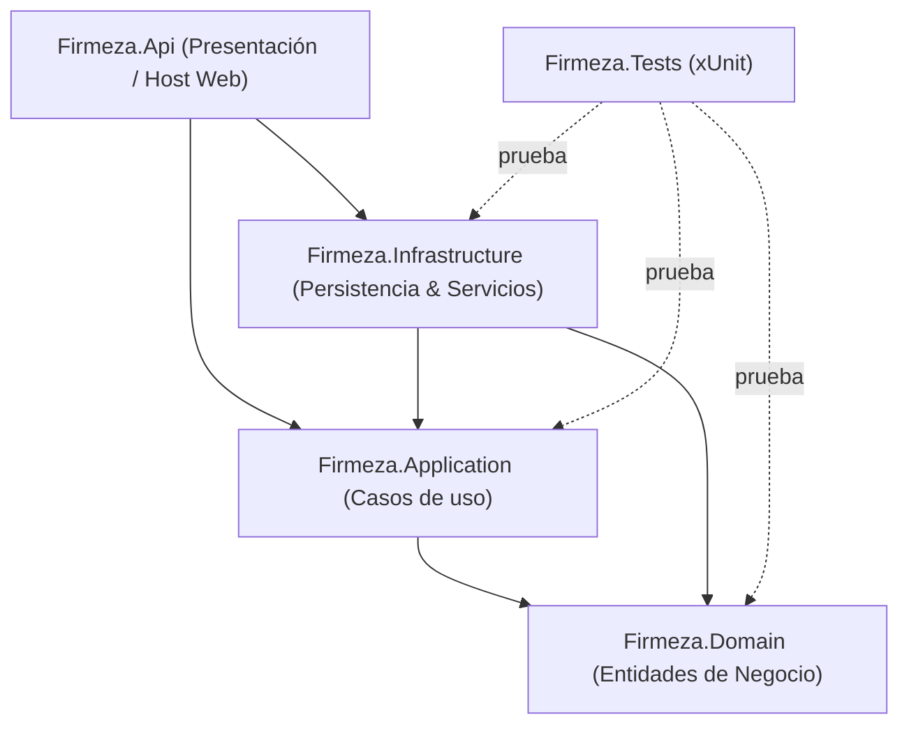

# Firmeza — Solución Empresarial ASP.NET Core & React

Sistema empresarial completo para la gestión de suministros, clientes, ventas y facturación electrónica, desarrollado con **.NET 10** bajo **Clean Architecture** (Arquitectura Limpia) y un cliente web en **React + TypeScript + Vite**.

---

## 🏛️ 1. Arquitectura de la Solución (Clean Architecture)

La solución está desacoplada en capas concéntricas con estricta inversión de dependencias:



### Proyectos y Responsabilidades

| Proyecto | Capa | Responsabilidad |
|---|---|---|
| **`Firmeza.Domain`** | Dominio | Núcleo central independiente. Entidades puras (`Producto`, `Cliente`, `Venta`, `DetalleVenta`) e interfaces de repositorios (`IProductoRepository`, `IClienteRepository`, `IVentaRepository`, `IUnitOfWork`). |
| **`Firmeza.Application`** | Aplicación | Casos de uso y reglas operativas, interfaces de servicios (`IProductoService`, `IClienteService`, `IVentaService`, `IExcelService`, `IPdfReciboService`, `IAuthService`), DTOs y perfiles de mapeo con AutoMapper. |
| **`Firmeza.Infrastructure`** | Infraestructura | Persistencia relacional con PostgreSQL vía **Entity Framework Core**, **ASP.NET Core Identity**, `ApplicationDbContext` / `FirmezaDbContext`, repositorios, generación de recibos PDF con **iText 7**, importación/exportación de hojas de cálculo con **EPPlus** y tokens **JWT**. |
| **`Firmeza.Api`** | Presentación | Web API REST con controladores CRUD, endpoints de autenticación y panel administrativo, middlewares de seguridad, CORS, Swagger UI y Scalar. |
| **`Firmeza.Tests`** | Pruebas | Suite automatizada de pruebas unitarias en **xUnit** con 14 pruebas que validan el dominio, cálculo de totales, IVA, generación de PDF y exportación de Excel. |

---

## 🗄️ 2. Persistencia y Base de Datos (PostgreSQL & Database-First)

El proyecto cuenta con compatibilidad para flujo **Database-First**:

1. **Scripts SQL**: Ubicados en `scripts/schema.sql` para crear las tablas relacionales:
   - `productos` (id, nombre, precio, stock)
   - `clientes` (id, documento, nombre)
   - `ventas` (id, numero_venta, fecha, cliente_id, subtotal, iva, total)
   - `detalles_venta` (id, venta_id, producto_id, cantidad, precio_unitario, subtotal)
2. **Scaffold-DbContext**: Se proporciona el script `scripts/scaffold_database_first.sh` para ingeniería inversa con EF Core y Npgsql:
   ```bash
   dotnet ef dbcontext scaffold "Host=localhost;Database=firmeza_db;Username=postgres;Password=postgres" \
     Npgsql.EntityFrameworkCore.PostgreSQL \
     -o Persistence/Scaffolded \
     -c ApplicationDbContext
   ```
3. **ApplicationDbContext & FirmezaDbContext**: Disponibles e inyectados en el contenedor de servicios de .NET para máxima compatibilidad con las especificaciones del sistema.
4. **Inicializador y Semilla Automática**: Al arrancar la API, `FirmezaDbContextInitialiser` ejecuta migraciones automáticas y siembra el usuario administrador por defecto (`admin@firmeza.com` / `Admin123*`), roles del sistema (`Admin`, `Cliente`) y productos/clientes base.

---

## 🔒 3. Autenticación y Autorización (Identity + JWT)

- **ASP.NET Core Identity**: Gestiona la seguridad de contraseñas mediante hashing PBKDF2, unicidad de correos y asignación de roles.
- **JWT (JSON Web Tokens)**: Generación de tokens criptográficos firmados con HMAC-SHA256, incluyendo claims de identidad (`NameIdentifier`, `Email`, `Role`).
- **Seguridad en Endpoints**: Protección mediante atributos `[Authorize]` y validación de roles en tiempo de ejecución.
- **Rutas Duales (Español / Inglés)**: Para compatibilidad con clientes y pruebas de integración:
  - `/api/productos` y `/api/products` / `/api/Product`
  - `/api/clientes` y `/api/clients` / `/api/Client`
  - `/api/ventas` y `/api/sales` / `/api/Sale`
  - `/api/auth` y `/api/Auth`
  - `/api/admin` y `/api/Admin`

---

## 📊 4. Servicios Técnicos (EPPlus & iText)

### Importación y Exportación Excel (.xlsx) con EPPlus
- **Importación Masiva**: Endpoint `POST /api/admin/importar-excel` procesa archivos `.xlsx` identificando columnas de productos y clientes de forma dinámica e inteligente.
- **Exportación**: Endpoints `GET /api/admin/exportar-productos` (alias `/api/admin/products.xlsx`) y `GET /api/admin/exportar-ventas`.

### Generación de Recibo PDF de Venta con iText
- **Generación Automática**: Al registrar una compra mediante `POST /api/ventas`, se almacena y emite el recibo digital de forma inmediata.
- **Descarga Directa**: Endpoint `GET /api/ventas/{id}/recibo` genera el archivo PDF en tiempo real.
- **Contenido del Recibo**:
  - Encabezado con imagen corporativa y datos fiscales de Firmeza.
  - Metadatos de la venta: Número de comprobante (`FAC-YYYYMMDD-XXXX`) y Fecha/Hora exacta.
  - Información completa del cliente: Nombre o Razón Social y Documento / NIT.
  - Tabla de detalles: Producto, Cantidad, Precio Unitario y Subtotal.
  - Cuadro de totales desglosado: Subtotal neto, IVA (19%) y Total liquidado.

---

## 💻 5. Documentación Interactiva de la API

La API cuenta con soporte de documentación activa:
- **Swagger UI**: Disponible en `http://localhost:5249/swagger` (permite autenticación Bearer interactiva con el botón `Authorize`).
- **Scalar API Reference**: Disponible en `http://localhost:5249/scalar/v1`.
- **OpenAPI JSON**: Disponible en `http://localhost:5249/swagger/v1/swagger.json` y `http://localhost:5249/openapi/v1.json`.

---

## 🧪 6. Pruebas Unitarias (xUnit)

La solución incluye 14 pruebas automatizadas que cubren:
- Configuración del entorno de pruebas.
- Lógica de negocio y entidades de dominio (`Producto`, `Venta`).
- Validación de stock suficiente/insuficiente al descontar y agregar existencias.
- Cálculo de subtotal, IVA y total de ventas.
- Generación de comprobante PDF con cabecera válida `%PDF-` y formato iText.
- Generación y estructura de archivos Excel con EPPlus.

Para ejecutar las pruebas:
```bash
dotnet test Firmeza.slnx
```

---

## 🌐 7. Frontend (React + TypeScript)

El proyecto cuenta con un cliente frontend independiente ubicado en `../Frontend`:
- Construido con **React 19**, **TypeScript** y empaquetado con **Vite**.
- Catálogo de productos con filtro y búsqueda en tiempo real.
- Carrito de compras reactivo con validación de stock y cálculo de importes.
- Autenticación con sesión persistente en `localStorage` (Bearer JWT).
- Finalización de pedido (Checkout) y descarga inmediata del recibo PDF oficial.

Para ejecutar el frontend:
```bash
cd ../Frontend
npm install
npm run dev
```
Acceder en el navegador a `http://localhost:5173`.
